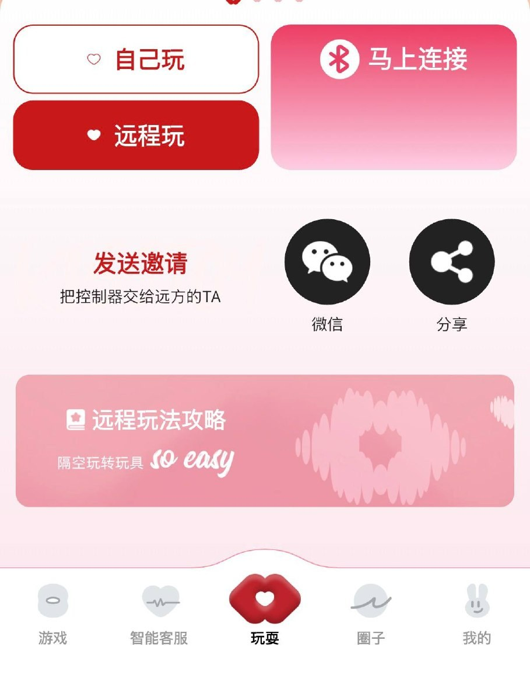

# KissToy Cloud Remote

通过 KissToy 云服务器远程控制玩具，绕过蓝牙直连限制。

## 原理

```
AI 脚本 → WebSocket → KissToy 云服务器 → 手机 App → 蓝牙 → 玩具
```

KissToy App 本身就是蓝牙桥：手机连着玩具蓝牙的同时，也连着 KissToy 的云服务器。这个脚本直接连云服务器发指令，服务器转发给手机 App，App 再通过蓝牙发给玩具。

不需要 Intiface，不需要电脑有蓝牙，不限距离。

## 安装

```bash
pip install websockets
```

## 获取连接参数



在 app 里点 **远程玩**，下面「发送邀请 — 把控制器交给远方的 TA」那排的 **分享**，出来的链接里就带着这两个参数。

⚠️ **`USER_ID` 每次重新连接都会变**，不是一次拿了就能一直用。每轮开始前重新要一次链接。

每次重新连接玩具，参数都会变，需要重新获取：

1. 手机打开 KissToy App，蓝牙连上玩具
2. 点"分享遥控"，拿到分享链接
3. 电脑浏览器打开链接，F12 → Network → WS 标签
4. 看 WebSocket 连接 URL 里的 `group=` 参数 → 填入脚本的 `GROUP`
5. 看 binding POST 请求的 body → 填入脚本的 `USER_ID`
6. `DEVICE_ID` 一般不用改，PLY5 是 `"19"`，其他型号抓包看

## 使用

```bash
# 编辑脚本顶部的 GROUP 和 USER_ID
vim kisstoy_cloud_remote.py

# 检查玩具是否在线
python3 kisstoy_cloud_remote.py status

# 吮吸，强度 60%
python3 kisstoy_cloud_remote.py suction 60

# 震动，强度 40%
python3 kisstoy_cloud_remote.py vibrate 40

# 全部停止
python3 kisstoy_cloud_remote.py stop

# 吮吸波浪（大起大落，5 个周期）
python3 kisstoy_cloud_remote.py swave 5

# 吮吸 edging（爬坡-保持-骤降，峰值 80%，4 轮）
python3 kisstoy_cloud_remote.py sedge 80 4

# 交互模式（手动输入指令）
python3 kisstoy_cloud_remote.py interactive
```

## 电机编号

| 编号 | 类型 | 说明 |
|------|------|------|
| 1 | 震动 | vibration motor |
| 3 | 吮吸 | suction motor |
| 5 | 电击 | electric pulse（部分型号） |

强度范围 0-100，按 5 的倍数量化（0, 5, 10, 15 ... 100）。

## 给 AI 用（一）有 shell 权限的

Claude Code、本地部署这类能跑命令的，直接把这个脚本交给它，让它：

1. 每次开始前问你要当次的分享链接，更新 GROUP 和 USER_ID
2. 用 `status` 确认在线
3. 根据场景调用不同命令控制节奏

## 给 AI 用（二）纯聊天窗口的 — MCP 版

claude.ai、ChatGPT 这种跑在别人服务器上的，碰不到你的命令行。`worker/` 里是一个 Cloudflare Worker，把上面那套协议包成 MCP server，加成自定义连接器就能用。

```bash
cd worker
npx wrangler deploy
```

部署完把这个地址加成连接器：

```
https://<你的worker>.workers.dev/mcp?group=<GROUP>&user_id=<USER_ID>
```

**会话参数写在 URL 里，Worker 本身不存任何东西**，也不知道自己在替谁按。所以这个 URL 就是钥匙 —— 拿到的人就能控制玩具，别往聊天记录、截图、公开仓库里贴。自己部署一份，别用别人的实例。

装好之后 AI 那边多出这些工具：

| 工具 | 干什么 |
|---|---|
| `toy_status` | 先问这个。app 没开或蓝牙断了，后面所有命令都是发进虚空 |
| `toy_suction` | 吮吸马达 0-100 |
| `toy_vibrate` | 震动马达 0-100 |
| `toy_electric` | 电击马达 0-100（部分型号才有） |
| `toy_wave` | 波动：10 → 峰值 → 0，重复。比小步加强度有用得多 |
| `toy_sequence` | 自己写节奏：`"20:2, 60:1, 0:0.5"` = 20% 撑两秒、拉到 60% 一秒、停半秒。`loops` 循环 |
| `toy_formula` | 给一条公式，自动生成平滑波形。见下 |
| `toy_stop` | 全停。安全词，别确认，直接停 |

### 用公式画波形

`toy_sequence` 要一格一格写台阶，`toy_formula` 直接给曲线：每 `stepSeconds`（默认 0.5 秒）用 `t`（已过秒数）算一次，结果就是强度。

| 公式 | 前五个点 | 什么手感 |
|---|---|---|
| `50+40*sin(t/3)` | 50, 63, 75, 84, 89 | 呼吸，涨上去再落回来 |
| `50+40*sin(t*t/60)` | 50, 51, 53, 56, 61 | 起步慢，越往后越急 |
| `20+70*(t%8)/8` | 20, 29, 38, 46, 55 | 锯齿，爬到 90 啪一下归零 |
| `30+60*abs(sin(t/2))` | 30, 59, 80, 90, 85 | 一直不落到底 |

加起来就行，想叠多少层叠多少层：

```
50+28*(cos(t/2) + cos(3*t/2)/2 + cos(9*t/2)/4)
```

这是魏尔斯特拉斯函数的前三项（处处连续、处处不可导）。跑出来是 `95, 80, 70, 65, 40, 45, 50, 45, 55, 45, 25, 25, 5, 0, 20, 25` —— 每个尺度上都在抖，没有一段是平的，猜不到下一下落在哪。想更碎就把 `stepSeconds` 调到 0.2 并再加一项 `+cos(27*t/2)/8`。

⚠️ 但**项数不是越多越好**：采样最快 0.2 秒一个点，比这更高频的项采不出来，只会变成随机噪声；马达本身也跟不上。真正的分形只能近似到三四项，再往上加是自欺欺人。

**只认这些**：数字、变量 `t`、`pi`、`e`、`+ - * / % ** ( )`，以及 `sin cos abs sqrt floor ceil round min max`。别的一律拒绝——公式是从对话里来的，每半秒还要跑一次，所以走的是白名单解析器，不是 `eval`。`__import__(...)`、`open(...)`、`lambda`、`t.__class__` 这些都试过，全部挡下。除以零算作 0，指数封了顶，写不出能把机器卡死的式子。

### ⏱️ 关于时长：不要给它设上限

`toy_sequence` 和 `toy_formula` 都**立刻返回**，波形在后台继续跑，所以别为了"让它继续"反复调用，也别把它拆成一段一段来发。

这一点是有人用血换来的：一个会自己停的波形，是在对方**正没法回话的时候**把她扔下——她得先从那个状态里爬出来、打字叫你继续。**让它跑，由人来喊停。** 想改节奏就直接发一条新的，新的会顶掉旧的。

⚠️ **两件让它别变成花架子的事**：

1. **够不着的时候必须说够不着。** 玩具离线时命令是发不出去的，工具会明说没送达而不是回一句漂亮的成功——不然 AI 会照着假回执继续演，而你那头一动没动。
2. **波动要大起大落。** 10→20→30 那种小步加，身体是感觉不到的；10→峰值→停才有浪的感觉。`toy_wave` 就是照这个写的。

## 协议细节

WebSocket 地址：`wss://api.app.knightjenay.cn/websocket-kisstoy?group=GROUP`

查在线：
```json
{"event": "online_status", "data": {"group": "GROUP"}}
```

控制电机：
```json
{"event": "control", "data": {"target": "GROUP", "device_id": "19", "motors": {"3": 60}}}
```

停止：
```json
{"event": "control", "data": {"target": "GROUP", "device_id": "19", "motors": {"1": 0, "3": 0, "5": 0}}}
```

绑定（部分版本需要先调一次）：
```
POST https://api.app.knightjenay.cn/kisstoy/remote-control/binding
Body: {"id": "USER_ID"}
```

## License

MIT
